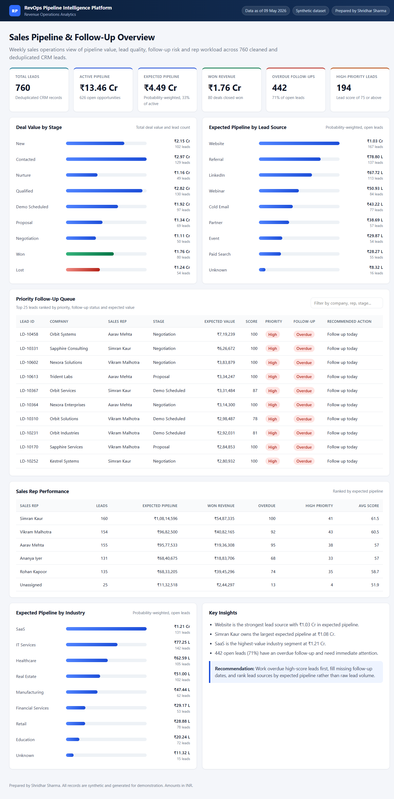

# RevOps Pipeline Intelligence Platform

CRM data cleansing, lead scoring, and sales pipeline analytics built with Python, SQL (SQLite), and an HTML dashboard.

**Author:** Shridhar Sharma | B.Tech in Information Technology, Chandigarh Group of Colleges, Landran | Former Business Development Executive (BDE)

<!-- TODO: after creating the repo under Shridhar's GitHub account, add the repo link and the GitHub Pages dashboard link here. -->



## Summary

This project turns messy CRM lead exports into a clean, scored, and analysis-ready dataset, then reports on pipeline value, lead source quality, sales rep workload, and overdue follow-ups. It supports the weekly sales review that a business development or sales operations team runs.

## Business Scenario

A B2B sales team manages leads across CRM exports and spreadsheets. The data has quality problems that block reliable reporting:

- Duplicate lead records
- Inconsistent lead source, industry, and sales stage labels
- Missing or overdue follow-up dates
- Invalid or missing deal values
- No lead prioritization
- No consolidated view of pipeline value by sales rep, lead source, stage, or industry

Result: slow follow-ups, inaccurate pipeline forecasts, and lost revenue opportunities. This project fixes the reporting workflow end to end.

## Key Results (synthetic dataset)

- 760 CRM leads cleaned and deduplicated from 784 raw records
- INR 13.46 Cr active pipeline value analyzed
- INR 4.49 Cr probability-weighted (expected) pipeline calculated
- INR 1.76 Cr won revenue identified
- 442 overdue follow-ups surfaced
- 194 high-priority active leads identified
- Prioritized follow-up queue with recommended next actions

## What the Pipeline Does

1. Generates a realistic, messy CRM lead dataset (reproducible, seeded).
2. Cleans and standardizes fields: lead source, industry, region, stage, dates, deal values, and flags.
3. Deduplicates records, keeping the most advanced stage and latest contact.
4. Scores each lead (0 to 100) using stage, source, email engagement, meetings, deal value, and contact recency.
5. Classifies follow-up status: Overdue, Due Today, Due This Week, Missing Follow-Up, Scheduled, Closed.
6. Loads the cleaned data into a SQLite database.
7. Runs SQL for KPI summary, follow-up queue, sales rep performance, lead source performance, stage analysis, and industry pipeline.
8. Exports reporting-ready CSV files.
9. Generates an HTML dashboard and an executive summary.

## Skills and Tools

Python, SQL, SQLite, ETL, Data Cleaning, Data Standardization, Deduplication, Lead Scoring, Sales Pipeline Analysis, KPI Reporting, CRM Analytics, Dashboard Development (HTML/CSS), Revenue Operations, Business Development.

## Project Structure

```text
src/build_case_study.py            Main pipeline: generate, clean, score, load, analyze, report
scripts/build_dashboard_preview.py Optional: renders the PNG preview (needs Pillow)
sql/analysis_queries.sql           SQL used for the analysis
data/raw/                          Raw messy CRM export
data/processed/                    Clean data, SQLite database, and report CSVs
reports/                           HTML dashboard and executive summary
assets/screenshots/                Dashboard preview image
case_study.md                      Project write-up
```

## How to Run

Requires Python 3.10 or later. The main pipeline uses only the standard library.

```powershell
python src/build_case_study.py
```

Then open `reports/pipeline_intelligence_dashboard.html` in a browser.

Optional: regenerate the PNG preview.

```powershell
pip install -r requirements.txt
python scripts/build_dashboard_preview.py
```

## Notes

- All data is synthetic. Company, contact, and sales rep names are placeholders.
- Currency is INR, shown with Indian digit grouping (lakh and crore).

